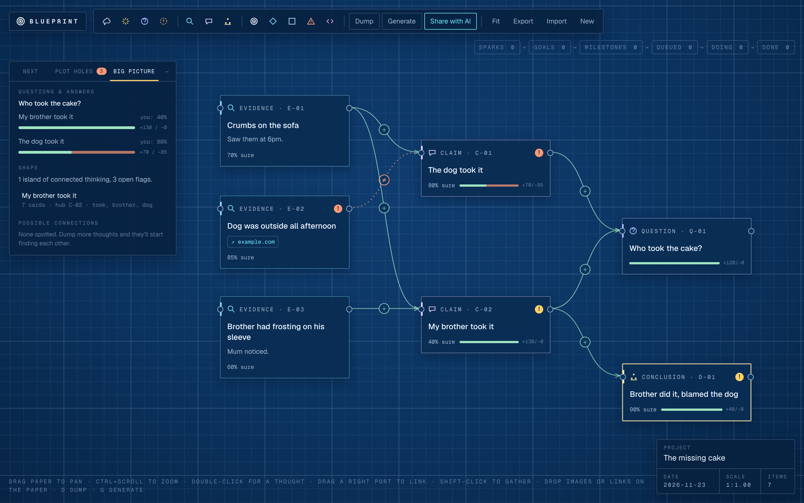

# Blueprint

**Live:** https://shafin2954.github.io/blueprint/



An idea-to-action planner drawn on blueprint paper. Ideas go in on the left, goals sit on the right, and the plan always tells you the next small move.

```
SPARK ─► GOAL ─► MILESTONE ─► STEP (todo → doing → done)
           ▲          ▲
     SNIPPET / RISK feed in as raw material and counter-moves
```

A place for your own brain to play: no AI inside, no network calls, nothing prebuilt about *what* you think. Use it to unravel an idea, work through a big question ("does God exist?"), solve a mystery from the clues you've found, or plan a project.

## What it does

**Think loosely.** Press **D** and dump whatever's on your mind, one line per card. Double-click the paper for a single thought.

**Collect what you've found.** *Evidence* cards hold what you found or observed. Attach a picture (button, paste, or drop it on the paper) or a source link. Dropping a link onto the paper makes an evidence card for it.

**Say what you think, and how sure you are.** *Claims* are things you think might be true; *assumptions* are things you're taking for granted. Each has a "how sure am I?" slider.

**Put it together.** Link evidence to claims as **supports** or **contradicts**. Each card shows a for/against bar: every linked card adds its own confidence to that side. Shift-click several cards and hit **Combine → conclusion** to deduce what they mean together.

**Compare rival answers.** Link several claims into a *Question* and the *Big picture* tab ranks them by the weight of evidence. Your own confidence is shown beside each one, so you can see where they disagree.

**Catch plot holes.** The checker only looks at how cards connect and how sure you said you are, never at what the words mean:

| Reasoning | Planning |
|---|---|
| **A leap**: a conclusion with nothing under it | **A wish, not a plan**: a goal with no steps |
| **More sure than your reasons** | **Untested assumption** (one click adds a test step) |
| **Belief vs. evidence**: you're sure, but the weight says otherwise | **That's not a 30-minute step** (one click splits it) |
| **Inconvenient evidence** cutting against a strong belief | **No "why" on record** |
| **Built only on beliefs**: no evidence anywhere underneath | Steps leading nowhere, risks without a counter-move |
| **Hangs on one thread**, **holding both sides**, **sure of rival answers**, evidence with no source | Floating cards, open questions |

**Plan.** *Next* shows the steps you can start right now; goal progress is worked out from the steps feeding it.

**Generate.** Offline prompts to push your own thinking: creative lenses (shrink, invert, collide, constrain…) and AI-era angles (new scarcity, trust, glue work, tools for agents…).

## Help

Press **?** (or the ? button) for a searchable guide to every card, link, plot-hole check and tool, each with a short explanation and a mini diagram. The **?** on any plot-hole flag opens that check's entry.

**Start** (shown on an empty sheet) offers a way in: three worked examples (a mystery, a decision, a project plan), a step-by-step **tour** of the mystery, and fill-in **templates** (weigh a decision, solve a mystery, test a belief, plan a project) whose `[placeholders]` you replace in your own words. If your sheet has cards, it opens as a new sheet instead.

## Share with AI (optional, outside the app)

Blueprint never talks to an AI. **Share with AI** turns the board into a Markdown file: every card with its confidence and source, every link, how the weights add up, and the flags already raised, with a consistency-check request on top. Copy it or download the `.md`, then paste it into any assistant for a second opinion on whether your thinking holds together. Images aren't included.

## Install

Blueprint is an installable web app: on a phone use **Share → Add to Home Screen** (iPhone) or **⋮ → Install app** (Android); on desktop, the install icon in the address bar. It then opens full-screen and works offline.

## Safety

- **Undo / redo everything** with ↶ ↷ or Ctrl/⌘+Z, Ctrl/⌘+Shift+Z. Deleting shows a toast with an Undo button.
- **Sheets:** keep as many boards as you like (new, open, rename, duplicate, delete). They save automatically in this browser; use **Export** to back one up or move it to another device.

## Run

```bash
npm install
npm run dev      # http://localhost:3000
npm test         # unit tests for the graph, weighing, plot-hole checks and export
npm run build    # static site in ./out
```

## Deploy

It's a fully static site (no server, no API keys), so any static host works.

**GitHub Pages:** push to a **public** repo's `main` branch, then in *Settings → Pages* set **Source: GitHub Actions**. The included workflow (`.github/workflows/pages.yml`) tests, builds with the right base path, and publishes to `https://<user>.github.io/<repo>/` on every push.

**Netlify / Vercel / Cloudflare Pages:** build command `npm run build`, publish directory `out` (see `netlify.toml`).

## License

MIT — see [LICENSE](LICENSE).
